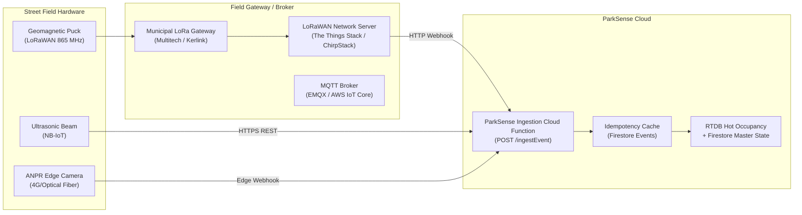

# ParkSense Hardware Integration & Sensor Protocol (SENSORS.md)

## 1. Overview: How Real Sensors Plug In

ParkSense is designed to ingest telemetry from three primary classes of street-parking sensors deployed in Indian municipalities:

1. **Surface Geomagnetic + Radar Pucks** (e.g., PNI PlacePod, Honeywell, Sensit):
   - Battery-powered (5–7 year lifespan), flush-mounted into asphalt.
   - Detects magnetic field perturbations caused by vehicle ferrous chassis + radar verification to prevent false triggers from iron manholes or nearby moving vehicles.
   - Communicates via **LoRaWAN (865–867 MHz India Band)** to municipal outdoor gateways.

2. **Overhead / Pole Ultrasonic Sensors** (e.g., banner ultrasonic, Sick):
   - Deployed on street light poles (BSES/Tata Power poles in Delhi).
   - Direct line-of-sight ultrasonic time-of-flight measurement to detect presence.
   - Communicates via cellular NB-IoT or 4G LTE-M.

3. **High-Mounted ANPR Vision Edge Cameras** (e.g., Hikvision, Axis, custom edge Jetson):
   - Installed at street zone entry/exit choke points or street lighting brackets.
   - Performs edge OCR on Indian high-security registration plates (HSRP) conforming to MoRTH formats.
   - Emits instantaneous arrival/departure events with license plate and confidence scores over HTTPS.

---

## 2. Ingestion Gateway Topology



---

## 3. Ingestion Webhook Specification

The edge gateways or LoRaWAN Network Server (LNS) dispatch payloads to the ParkSense ingestion endpoint:

```http
POST /ingestEvent HTTP/1.1
Host: api.parksense.gov.in (or local emulator http://127.0.0.1:5001/parksense-india/us-central1/ingestEvent)
Content-Type: application/json
X-ParkSense-Signature: sha256=3c9b7e...
```

### 3.1 JSON Payload Schema

```json
{
  "gatewayId": "GW-DEL-CP-01",
  "sensorId": "sns-cp-001",
  "bayId": "bay-del-cp-001",
  "zoneId": "delhi-cp-inner",
  "eventType": "ENTRY",
  "timestamp": 1774254000000,
  "idempotencyKey": "sns-cp-001_1774254000000_ENTRY",
  "vehicleMetadata": {
    "detectedClass": "car",
    "licensePlate": "DL1CAB1234",
    "confidenceScore": 0.94
  },
  "telemetry": {
    "batteryVoltage": 3.62,
    "signalRssi": -78,
    "temperatureC": 34
  },
  "signature": "e4d909c290d0fb1ca068ffaddf22cbd0ffd82432a65"
}
```

### 3.2 Payload Field Definitions

| Field | Type | Required | Description |
| :--- | :--- | :--- | :--- |
| `gatewayId` | `string` | Yes | Hardware identifier of the receiving gateway |
| `sensorId` | `string` | Yes | Unique sensor serial number or DevEUI |
| `bayId` | `string` | Yes | Municipal bay designation (`bay-del-cp-001`) |
| `zoneId` | `string` | Yes | Municipal zone identifier (`delhi-cp-inner`) |
| `eventType` | `enum` | Yes | `'ENTRY'`, `'EXIT'`, `'HEARTBEAT'`, `'TAMPER'`, `'OVERSTAY_ALERT'` |
| `timestamp` | `number` | Yes | Epoch milliseconds from calibrated RTC on sensor |
| `idempotencyKey`| `string` | Yes | Unique composite key ensuring exactly-once processing |
| `vehicleMetadata`| `object`| No | Vehicle type (`car`, `two_wheeler`, `ev`) and detected license plate |
| `telemetry` | `object`| No | Battery level, RSSI, operating temperature |
| `signature` | `string` | Optional | HMAC-SHA256 signature for authentication |

---

## 4. Hardware Security & Cryptographic Verification

In production municipal deployments:
1. **Shared Secret / HMAC-SHA256**:
   Each gateway is provisioned with a secure symmetric key (`GATEWAY_SECRET_KEY`). Payloads are signed:
   $$\text{signature} = \text{HMAC-SHA256}(\text{rawBody}, \text{secret})$$
2. **Replay Protection**:
   Events older than 300 seconds (5 minutes) from server time are rejected to prevent replay attacks.
3. **Idempotency Guarantee**:
   If network jitter causes a gateway to retry transmission, the Cloud Function checks the `idempotencyKey` against `/events/{idempotencyKey}`. If already processed, it returns `200 OK` without duplicating database mutations.

---

## 5. Typical LoRaWAN Payload Decoder (ChirpStack / TTN JavaScript)

For battery efficiency, ground pucks send compact binary frames (11 bytes):
- Byte 0: Status flags (Bit 0: Occupied, Bit 1: Tamper, Bit 2: Low battery)
- Byte 1-2: Battery voltage (mV)
- Byte 3-6: Unix timestamp (seconds)
- Byte 7-10: Sensor sequence counter

The LNS uplink decoder transforms this binary frame into the ParkSense JSON payload and forwards it to the `/ingestEvent` Cloud Function.
